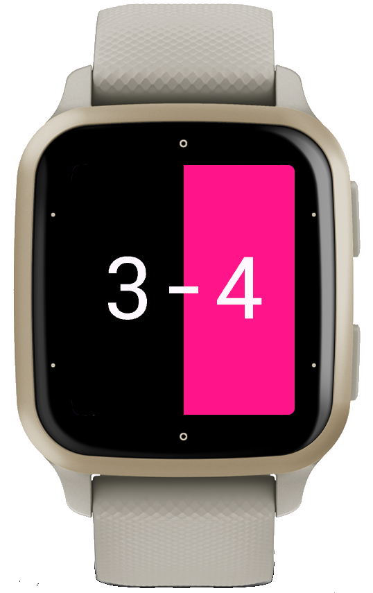

# CountScore

A Garmin Connect IQ watch app for keeping score in simple two-team games — press a button or tap a side of the screen to add a goal for that team, see the score as `6-3`.



## Features

- Two-team score counter with configurable colors per team, set via the Connect IQ app on your mobile device
- Touch screen and button [controls](#controls), see below
- Undo a mis-tap or a disqualified goal (touch devices only)
- Optionally records a FIT activity alongside the score, so e.g. a volleyball player keeping score also gets the game logged as an activity
- Score is persisted across restarts; reset always asks for confirmation first

## Controls

### Touch actions

On devices with a touch screen, you have the following controls:

| Control                    | Action                                                                                  |
|----------------------------|-----------------------------------------------------------------------------------------|
| Tap on the left side       | Increment the left team's score                                                         |
| Tap on the right side      | Increment the right team's score                                                        |
| Swipe right-to-left        | Decrement the left team's score (or increment, or disabled — see [Settings](#settings)) |
| Swipe left-to-right        | Decrement the right team's score (same)                                                 |
| Swipe upwards              | Reset scores (will confirm)                                                             |
| Swipe downwards            | Exit (close app)                                                                        |

### Button actions on two-button devices

On devices with two physical buttons, you have the following controls in addition to the touch gestures:

| Button                     | Action                            |
|----------------------------|-----------------------------------|
| Upper (START/ENTER)        | Increment the left team's score   |
| Lower (BACK/ESC)           | Increment the right team's score  |
| Long-press lower           | Show Exit/Reset menu              |

### Button actions on five-button devices

On devices with five or more physical buttons, you have the following controls:

| Button                     | Action                            |
|----------------------------|-----------------------------------|
| UP                         | Increment the left team's score   |
| START/ENTER                | Increment the right team's score  |
| DOWN                       | Reset scores (will confirm)       |
| BACK/ESC                   | Exit (close app)                  |

(The watch apps cannot use the LIGHT button.)

## Settings

Configurable via the Connect IQ app on your phone (or Garmin Express), under this app's settings:

- **Left team color** / **Right team color** — defaults to black / pink.
- **Touch screen** — only relevant on devices with a touch screen:
  - *Swipe to undo* (default) — swiping left/right decrements that side's score, for undoing an accidental tap or a disqualified goal.
  - *Swipe to score* — swiping left/right increments that side's score instead, the same as tapping. There's no way to undo a point in this mode.
  - *Touch screen off* — tapping and swiping are both ignored entirely. Hold the lower button to reset the score or to exit the app.

  Garmin's "lock touch screen during activity" doesn't apply to third-party watch-apps like this one.

### No way to undo a point?

If you're on a button-only watch, or you've disabled the touch screen, there's no way to decrement a score. The workaround is to reset the score and re-enter both teams' correct scores.

## Activity recording

On watches that support it, the app opens with a sport picker ("Activity?") before showing the score screen. Pick a sport to start a FIT recording alongside the score, or "Don't record" to skip it. The recording is stopped and saved whenever you exit the app (via the menu, the exit button, or swipe-down).

## Building

Requires the Connect IQ SDK (`monkeyc` on `PATH`) and a developer key.

```sh
monkeyc -f monkey.jungle -d <device_id> -o bin/CountScore.prg -y /path/to/developer_key.der
```

To build the full release package (every device in the manifest, in one `.iq` file):

```sh
monkeyc -f monkey.jungle -o bin/CountScore.iq -y /path/to/developer_key.der -e -r
```

## Running in the simulator

```sh
open "$CIQ_HOME/bin/ConnectIQ.app"   # or just `connectiq` if it's on PATH
monkeydo bin/CountScore.prg <device_id>
```

## Supported devices

`manifest.xml` lists every device that's API level 3.0+ and supports the `watch-app` type — currently 157 products / 263 variants, spanning Fēnix, Forerunner, Venu, vívoactive, Instinct, MARQ, D2, Descent, Approach, Edge, and handheld GPS units (GPSMAP, Montana, Oregon, eTrex, Rino). All of them work via the [controls](#controls) above, even ones that aren't wrist-worn (Edge cycling computers, handheld GPS) — they just lean more on touch or on whatever button set they happen to have.

Please note: eTrex Touch's device profile reports no physical buttons at all. Don't set "Touch screen" to *off* on a device like that; there'd be no way to exit the app.
